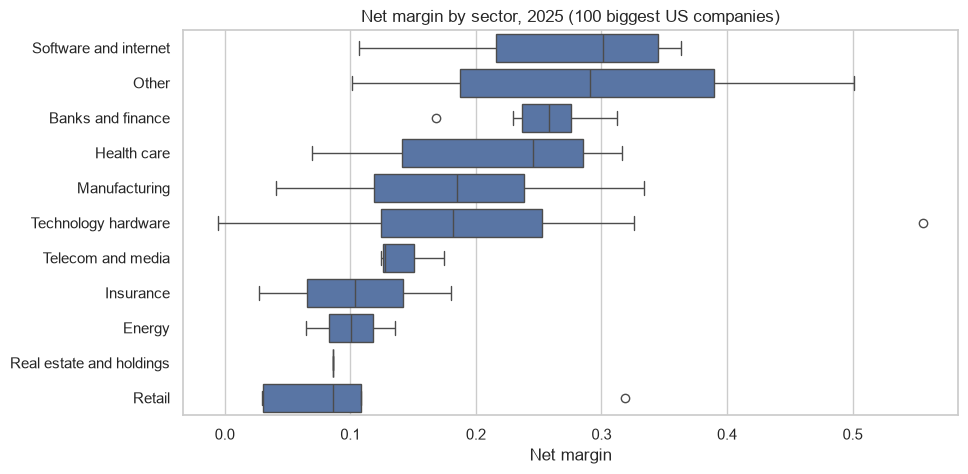
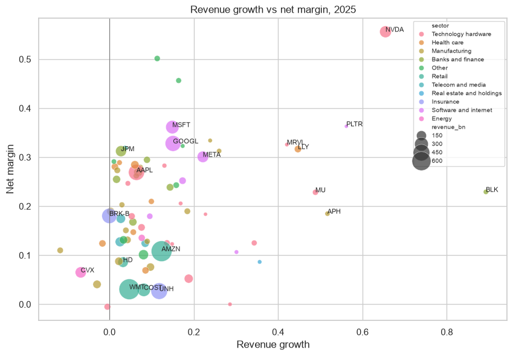

# SEC financial statements pipeline with dbt and DuckDB

An ELT pipeline that takes the XBRL financial statements of the 100 biggest US listed companies from the SEC, loads them in DuckDB and transforms them with dbt into tables ready for analysis (annual financials and ratios), with data quality tests and CI on GitHub Actions.

## Pipeline

```
SEC API (company facts, submissions)
   -> ingest/download_sec.py        raw layer: data/raw/facts.parquet, companies.csv
   -> models/staging                clean types, only USD, one calendar frame per value
   -> models/intermediate           map 17 XBRL tags to 12 line items (revenue alone has 4 tags)
   -> models/marts                  fct_annual_financials, fct_financial_ratios
   -> analysis.ipynb                questions on the marts
```

## Data quality
- Generic tests: unique and not null keys, accepted values for the sector, unique combination of company and year, positive assets.
- Singular test: assets = liabilities + equity (5% of tolerance). It finds 22 rows of 758; they are real cases (temporary equity before an IPO, equity without minority interests), so it is a warning and they are documented in the notebook.
- Two problems I found while building it:
  - SEC gives the calendar frame to the most recent filing, so a year-end balance often comes from the next 10-Q. Filtering only 10-K made equity disappear for 2025.
  - Foreign filers (Toyota, Mitsubishi UFJ, ASML...) report in their own currency, so the staging layer keeps only USD.

## Some results (2025)
- Median net margin: software and internet 30%, banks 26%, health care 25%, retail 9%.
- Coverage of the marts: around 95% of the companies have revenue, net income and equity every year since 2010.




## How to run

```
pip install -r requirements.txt
python ingest/download_sec.py      # optional, the raw data is already in data/raw
dbt build --profiles-dir .
jupyter notebook analysis.ipynb
```

---
Alejandro Lezcano Osorio | Rennes School of Business (MSc in Financial Data Intelligence) and Universidad EIA
